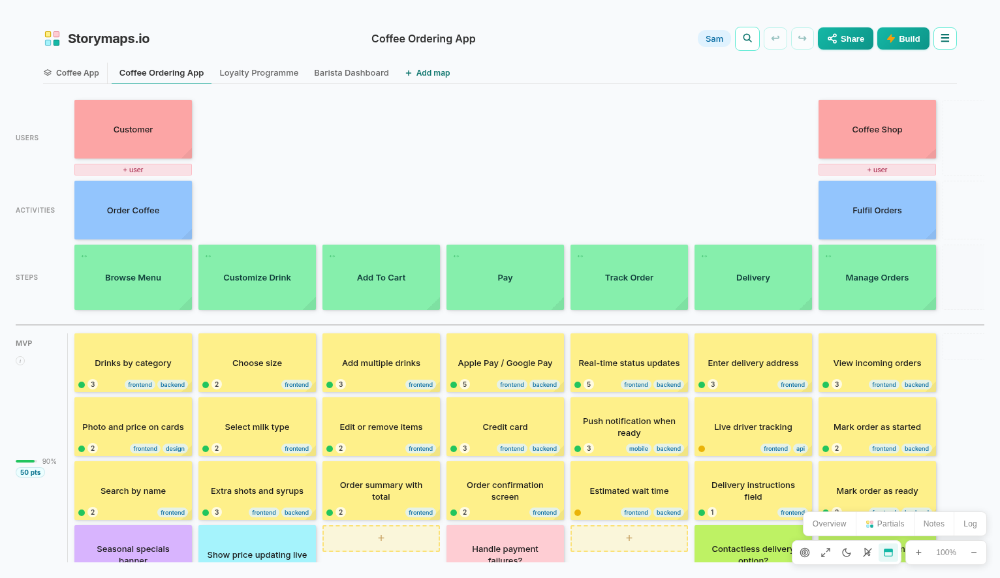

# Storymaps.io

A free, open-source user story mapping tool with real-time collaboration. No sign-up needed, no paywall and no trials.



- **Use it** at [storymaps.io](https://storymaps.io)
- **Learn it** in the [docs](https://storymaps.io/docs): how story mapping works, and a guide for every part of the app
- **Build on it** from the [Developers page](https://storymaps.io/developers): the CLI, AI coding agents and self-hosting

## What is a user story map?

A user story map lays a product out as the journey its users take. It shows who the product is for, what they do, the work behind each step and what ships in each release, all in one place.

- **Users** - who the product is for, e.g. first-time shopper
- **Activities** - what they're trying to do, e.g. find a product
- **Steps** - the journey they take, from left to right, e.g. search, browse, compare
- **Tasks** - the work behind each step, e.g. keyword search, category filters
- **Slices** - rows that group tasks into releases, e.g. MVP, V1, V2

A larger product can span several story maps, grouped as a **project** so they sit side by side as tabs.

[What is a user story map?](https://storymaps.io/docs/what-is-a-user-story-map) explains each part, and [Why user story mapping](https://storymaps.io/docs/why-user-story-mapping) explains what it changes for a team.

## Features

- **Story mapping** - a backbone of users, activities and steps, task cards with status, points, tags and colours, and release slices with goals and dates
- **Real-time collaboration** - several people on one story map at once, with live cursors, a shared notepad and an activity log
- **Projects** - related story maps as tabs under one link
- **Import and export** - JSON, YAML and CSV files, and Jira, Asana, Phabricator, Linear and Azure DevOps by file or API
- **Data links** - add `.json`, `.yaml` or `.csv` to any story map link to fetch it as data
- **Build with AI** - turn a story map into a prompt for app builders, AI chats and AI coding agents
- **Backups and locks** - named snapshots to roll back to, and a password lock against edits
- **Partials** - shared steps written once and reused across a story map
- **Finding your way around** - search, filters, bulk edit, frozen rows, focus mode, full screen and dark mode

The [docs](https://storymaps.io/docs) have a guide for each of these.

## Command Line

The [Storymaps CLI](https://github.com/jackgleeson/storymaps-cli) keeps a map as a YAML file next to your code, so it can be version-controlled, reviewed in pull requests and handed to an AI coding agent:

```bash
npx storymaps pull storymaps.io/abc123    # download the map as storymap.yml
npx storymaps diff                        # see what you changed
npx storymaps push                        # send the changes back; people on the map see them straight away
```

It also has `init`, `status`, `log`, `lock`, `backup`, `restore`, `validate` and `convert`, and works with self-hosted instances. See the [CLI docs](https://storymaps.io/docs/cli) for every command.

## Architecture

The server entry point is `server.js`, which delegates to modules in `server/`:
- **WebSocket** - Real-time collaboration via y-websocket
- **Static files** - Serves the client app from `public/` and `src/`. Paths that can be a map, a project or a sample get the app page; anything else, like `/.env` or `/wp-login.php`, gets a 404
- **REST API** - Route handlers in `server/routes/` for locks, backups, projects, activity log, stats, format endpoints (`.json`, `.yaml`, `.csv`), and server-proxied third-party imports/exports with SSE progress streaming. Requests to Jira, Asana, Phabricator, Linear and Azure DevOps go only to public addresses over HTTPS. The server checks the address of each host name before connecting, connects to the address it checked, and checks again on every redirect
- **Middleware** - Origin checks, body parsing, and rate limiting in `server/middleware.js` and `server/rate-limit.js`. Through the API, each address can create 10 maps or projects a minute and 500 a day, push a map, change a project or request a new map ID 30 times a minute, and use the import, export, backup and unlock routes 10 times a minute

### Real-time Sync (Yjs)

Each map is a [Yjs](https://yjs.dev/) document named after its map ID. The server keeps one shared copy of each open map in memory, and every browser on the map keeps its own. Yjs merges edits from everyone into the same result whatever order they arrive in, so the server has no conflict-handling logic of its own.

**Document structure**
- **Map data** - the name, steps, users, activities, slices and their cards, legend, and map partials
- **Notepad** - shared text bound to the CodeMirror editor, so people can type in it at the same time
- **Activity log** - the feed of recent edits, trimmed to the last 20 entries

**Client**
- The app renders from a plain JavaScript state object, not from Yjs directly. After a local change, the state is written into the document in one transaction. Items that keep their order are updated field by field; a list whose items were added, removed, or reordered is rebuilt. Nothing is written if the state hasn't changed.
- Changes from other people are read back into the state and the map re-renders: the first change renders straight away, and a burst of changes is collapsed into one more render shortly after.
- Undo and redo restore snapshots of the local state rather than using Yjs's own undo, so an undo syncs to everyone like any other edit.
- Presence and live cursors use the Yjs awareness protocol. Each client shares its name, colour, device type, and cursor position; the server relays these to everyone on the map and never saves them.
- Yjs only loads when a map is opened, so it doesn't slow down the home page. A new map (from a sample, import, or copy) is written into the empty document after the first sync.

**Server**
- Each WebSocket connection is checked against the allowed origins, then joins its map's shared document through y-websocket, which runs the sync protocol and relays updates to everyone on the map.
- y-leveldb loads a map from disk when its first client connects and saves every update as it arrives. When the last client leaves, the in-memory copy is dropped. The map stays on disk as a list of updates, which y-leveldb merges into one once the list grows long.
- Shortly after editing stops, the map's name, last-edited time, and edit count are saved to SQLite for the map index and activity stats.
- The REST API works on the same documents. Format URLs read the in-memory copy if the map is open, and otherwise load it from disk. CLI pushes write into the live document, so people on the map see the change straight away, and add an entry to the activity log.
- On shutdown the server saves open documents and pending SQLite updates before it exits.

### Data Storage
- **LevelDB** - Yjs document persistence in `data/`
- **SQLite** - Map index with names and timestamps, and projects (`data/maps.db`)
- **JSON files** - Lock state (`data/locks.json`) and backups (`data/backups/*.json`), each saved to a temporary file and renamed into place, one change at a time

### Client
The client has no build step - ES modules are loaded directly from `src/`. Third-party libraries (Yjs, CodeMirror, html-to-image, js-yaml, html2canvas) are vendored as pre-built bundles in `public/vendor/`.

Page views on storymaps.io are counted with [Umami Cloud](https://umami.is), open-source web analytics that uses no cookies. It's loaded by `src/features/analytics.js`, only on that hostname, for the app and for the docs and site pages. It receives page addresses, including map links, and the names of a few actions such as creating a map or exporting, but no map content or display names.

## Self-Hosting

Storymaps is a single Docker container behind a Caddy reverse proxy. It runs on any Linux server and gives your team a private instance at e.g. `storymaps.yourcompany.com` with automatic HTTPS.

A self-hosted instance sends no analytics. The Umami script only loads on storymaps.io.

### Prerequisites
- A Linux server (VM, VPS, or container platform) - 512 MB RAM / 1 vCPU is sufficient
- Docker and Docker Compose
- A domain or subdomain with DNS pointing to the server

### Quick Start

1. Clone the repo:
   ```bash
   git clone https://github.com/jackgleeson/storymaps.io.git
   cd storymaps.io
   ```
2. Edit the `Caddyfile` - replace `storymaps.io` with your domain and remove the `www` redirect block. Keep the `header` block (security headers), the `log` block (access logs) and the `header_up` line, which passes the address of each visitor to the app. The block at the top trusts the Cloudflare addresses: keep it if your site is behind Cloudflare, otherwise delete it:
   ```
   storymaps.yourcompany.com {
       header {
           # ...security headers, unchanged
       }

       log {
           # ...access logs, unchanged
       }

       reverse_proxy app:8080 {
           header_up X-Forwarded-For {client_ip}
       }
   }
   ```
3. Edit `docker-compose.yml` and add your domain to the `app` service's `environment` section. `STORYMAPS_ALLOWED_ORIGINS` must list it, or browsers on it can't connect. `TRUST_PROXY=true` is already there; it lets rate limiting see each visitor's IP through Caddy instead of counting everyone as one client:
   ```yaml
   services:
     app:
       # ...
       environment:
         - TRUST_PROXY=true
         - STORYMAPS_ALLOWED_ORIGINS=https://storymaps.yourcompany.com
   ```
4. Build and start:
   ```bash
   docker compose up -d --build
   ```
5. Visit `https://storymaps.yourcompany.com` - Caddy provisions TLS automatically via Let's Encrypt.

### Behind an Existing Reverse Proxy

If you already run nginx, Traefik, HAProxy, or another proxy, you can skip Caddy and expose the app directly.

1. Remove the `caddy` service from `docker-compose.yml` and expose port 8080 on the `app` service. Binding to `127.0.0.1` keeps the app reachable only through your proxy:
   ```yaml
   services:
     app:
       image: storymaps-app
       build: .
       restart: unless-stopped
       volumes:
         - ./data:/app/data
       ports:
         - "127.0.0.1:8080:8080"
       environment:
         - STORYMAPS_ALLOWED_ORIGINS=https://storymaps.yourcompany.com
         - TRUST_PROXY=true
   ```
   Only set `TRUST_PROXY=true` if your proxy sets `X-Forwarded-For` and clients can't reach port 8080 directly; otherwise a client could fake its IP to dodge rate limits.
2. Point your existing proxy at `localhost:8080` and handle TLS termination there.

   Example nginx snippet:
   ```nginx
   server {
       listen 443 ssl;
       server_name storymaps.yourcompany.com;

       ssl_certificate     /path/to/cert.pem;
       ssl_certificate_key /path/to/key.pem;

       location / {
           proxy_pass http://localhost:8080;
           proxy_http_version 1.1;
           proxy_set_header Upgrade $http_upgrade;
           proxy_set_header Connection "upgrade";
           proxy_set_header Host $host;
           proxy_set_header X-Forwarded-For $proxy_add_x_forwarded_for;
       }
   }
   ```
   The `Upgrade` and `Connection` headers are required for WebSocket connections. `X-Forwarded-For` passes the visitor's IP through for rate limiting (with `TRUST_PROXY=true`).

### Data & Backups

All data lives in `./data/` on the host:
- LevelDB files - Yjs document state
- `maps.db` - SQLite map index and projects
- `locks.json` - lock state
- `backups/` - per-map backup snapshots

Back up this directory regularly (e.g. a cron job with `tar` or `rsync`). To migrate to a new server, copy `data/` across and start the containers.

Caddy keeps access logs in its own volume, rotated at 10 MB and kept for up to 30 days. Read them with `docker compose exec caddy tail -f /data/access.log`.

To delete a map, for example spam, stop the app and run the admin script with the map ID. It deletes one map per run and takes the map out of any projects, which stay in place. Add `--dry-run` first to see what would be deleted:
```bash
docker compose stop app
docker compose run --rm app node server/admin/delete-map.js <id>
docker compose start app
```

### Updating

```bash
git pull && docker compose build --pull && docker compose up -d
```

`--pull` fetches the latest `node:24-slim` base image, so Node security fixes reach your build even when an older copy of the image is cached. Data is preserved across rebuilds since `data/` is a host-mounted volume.

### Environment Variables

Set these in the `environment` section of the `app` service in `docker-compose.yml`. The app doesn't read a `.env` file.

| Variable | Default | Description |
|----------|---------|-------------|
| `PORT`   | `8080`  | Server listen port |
| `STORYMAPS_ALLOWED_ORIGINS` | storymaps.io origins | Comma-separated origins allowed to open WebSocket connections and write to the API, e.g. `https://storymaps.yourcompany.com`. Required when self-hosting on your own domain. `localhost` is always allowed. |
| `TRUST_PROXY` | unset (`true` in the bundled `docker-compose.yml`) | Set to `true` to take the client IP from `X-Forwarded-For` for rate limiting. Use it behind the bundled Caddy or another trusted proxy; leave it unset if clients can reach the app directly. |
| `DATA_DIR` | `./data` | Folder for the map database, lock state, counters and backups. |
| `IMPORT_EXPORT_ENABLED` | `true` | Set to `false` to turn off imports and exports through the APIs of Jira, Asana, Phabricator, Linear and Azure DevOps. The server then never calls an address someone types in, and the app hides those options. Imports and exports of JSON, YAML and CSV files still work. |
| `DISABLE_SSRF_CHECK` | unset | Set to `1` to let server-proxied imports and exports call non-HTTPS URLs, localhost, and private network addresses. This turns off SSRF protection, so use it for local development only. |

### Running Locally (Development)

```bash
npm install
npm start
```

The server starts on `http://localhost:8080`.

### Running the Tests

```bash
npm test                  # unit and integration tests
npm run test:unit         # unit tests only: a few seconds, no server
npm run test:integration  # starts the server on a spare port with a temporary data folder
npm run test:e2e          # browser tests in Chrome and phone-sized WebKit
```

- **Unit tests** (`test/unit`) cover saving and loading maps, projects, JSON, YAML and CSV import and export, real-time sync including two people editing at once, editing and partial maps, search, locks, backups, the activity log, and the Jira, Asana, Linear, Phabricator and Azure DevOps imports and exports against canned API responses.
- **Integration tests** (`test/integration`) start the real server to test WebSocket sync, origin checks, locks, projects, request handling and static files.
- **Browser tests** (`test/e2e`) use [Playwright](https://playwright.dev) to run the main journeys: editing a map, two people editing at once, menus and undo, locks, projects, and YAML import and export, plus phone layout checks. They start their own server on port 3210 (set `E2E_PORT` to change it), so they can run alongside a dev server. Locally they use your installed Chrome; run `npx playwright install webkit` once for the phone tests.

CI runs all of them on every push to `main` and every pull request.

## Support
If you find this tool useful, consider [buying me a coffee](https://buymeacoffee.com/jackgleeson). It goes towards server costs and helps me keep the app running.

## Credits
- Thanks to Jeff Patton for pioneering user story mapping. Learn more: [Jeff Patton's Story Mapping](https://jpattonassociates.com/story-mapping/)
- Real-time collaboration powered by [Yjs](https://yjs.dev/) CRDTs
- Drag and drop powered by [SortableJS](https://sortablejs.github.io/Sortable/)
- Collaborative notepad powered by [CodeMirror 6](https://codemirror.net/)

## Contributing
See [Contributing](CONTRIBUTING.md) for development setup, code style and contribution guidelines.

## License
AGPL-3.0 - see [LICENCE](LICENCE) for details.
